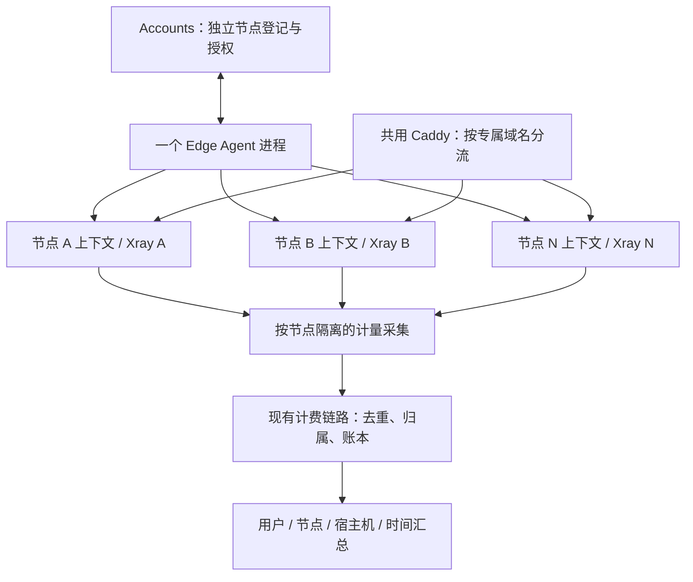

# 虚拟加速节点规划：单 Agent、多 Xray、共享 Caddy

> Status: IN PROGRESS — P0 audit and first guarded increment; multi-node runtime not implemented or deployed
> Date: 2026-11-02
> Task: https://github.com/ai-workspace-xstream/xconnect-edge-agent/issues/130
> Source audit and current boundaries: [P0 audit](2026-11-02-virtual-nodes-p0-audit.md)
> 范围：保持现有功能，补充虚拟节点及按节点分类的流量、账单和统计能力。

## 1. 已确认需求

- 一台高配置宿主机运行 **一个 xconnect-edge-agent 进程，管理 1～N 个可配置的 Xray 实例**，共用 Caddy。
- 每个 Xray 实例对应一个虚拟加速节点，拥有专属域名；Accounts 独立登记，用户界面显示多个节点。
- 每个虚拟节点都有完整、独立的身份、授权、服务与计量配置，为以后容器化调度准备。
- 保留现有单节点、多个传输目标、用户同步、授权撤销、健康上报、流量与计费功能。
- 沿用 free、plus、pro、team、custom 等现有资源等级、邮箱范围、有效期、套餐与福利包规则，不重新定义授权或价格。
- 流量和账单能按虚拟节点分类查询、汇总；同时保留按用户、宿主机和时间的统计。
- 2026-11-02 新任务已授权开发、测试和 PR；不部署生产、不改历史账单、不执行生产 SQL 迁移，不扩展为调度平台建设。

## 2. 源码检查与待核实边界

2026-11-02 已读取本仓库并刷新 `origin/main`，参考提交为
`44a2bcac8a2635d7069536294e34f54d12964c15`。当前工作区位于较早的文档分支，不能用其旧代码代替最新实现。以下为静态检查结论，不代表线上验收。

| 现有落点 | 检查结论 | 设计影响 |
| --- | --- | --- |
| `internal/config/config.go` | 单个 `Agent` 配置；包含 nodeId、资源等级、团队、allowedEmails；`xray.sync.targets` 支持多个目标 | 新增节点列表不能改变旧字段含义 |
| `internal/agentmode/runner.go` | 单个控制端 Client、节点上下文；同一控制端快照渲染多个 Xray target | target 是同一节点的传输/配置目标，不是独立节点 |
| `internal/agentproto/types.go` | 单次状态上报含 agentId 和一个 XrayStatus，后者含 nodeId 与授权元数据 | 优先每节点复用现有上报协议，核实服务端登记与鉴权约束 |
| `internal/agentmode/billing_client.go`、`billing_scheduler.go` | 提供 collect-and-rate / reconcile 作业触发，不是逐用户流量采集器 | 不能在每个节点上下文中重复启动全局计费作业 |
| `deploy/ansible/roles/xconnect_edge_agent/templates/xray-exporter.env.j2` | 现有模板传入单个 XRAY_STATS_URL、EXPORTER_NODE_ID 与监听地址 | 需核实 exporter、Vector 和 Billing 的多实例配置能力及实际所有者 |

本轮未检查 Accounts、Billing、Console 的最新源码与数据库，也未 SSH 检查线上。因此多节点是否需要服务端字段、索引或 SQL 调整仍为待确认项，不能承诺零 schema 变更。历史上链路服务运行并不等于计费数据端到端正确，实施时必须以新鲜明细和账本核验。

## 3. 架构与身份



区分四类标识：

| 标识 | 生命周期与用途 |
| --- | --- |
| hostId | 宿主机标识，供容量、成本、故障及分类汇总；不作为用户计费主体 |
| nodeId | 稳定虚拟节点标识，用于展示、授权、用量和历史账单归属 |
| agentId | 每节点控制端身份，优先复用现有登记机制；一个进程可承载多个逻辑身份，映射规则需核实 |
| runtimeInstanceId / counterEpoch | 某次 Xray 运行或统计计数周期，用于区分重启、归零和迁移 |

每个节点维护独立 Client、授权范围、同步版本、健康状态、重试退避及运行目录。凭据优先按节点绑定，服务端必须校验凭据与 nodeId/agentId 的对应关系，不能信任调用者任意填写身份来扩权或归账。暂不引入新的“宿主机超级凭据”。

更换域名、重启或迁移时 nodeId 保持不变；删除节点后保留历史归属，不把其 ID 分配给另一个节点。迁移时必须保证同一 nodeId 只有一个有效数据面写者/计量所有者，不能把新旧并行运行当成正常状态。

## 4. 配置设计

详细字段、加载与校验规则已拆分至 [虚拟节点配置格式设计（Draft v2）](../virtual-nodes-configuration-design.md)，完整 YAML/JSON 见 [配置示例](../examples/virtual-nodes/README.md)。所有新增字段均未实现，不能直接部署到当前版本。

```yaml
virtualNodes:
  enabled: false # 关闭或未配置：单节点，适合低配主机
```

```yaml
virtualNodes:
  enabled: true # 开启：一个 Agent 管理清单中 1～N 个独立 Xray
  hostId: host-us-01
  configRoot: /etc/agent/nodes
  maxConcurrentReconciles: 2
  nodes:
    - configFile: nodes/us-a/agent.yaml
      runtimeFile: nodes/us-a/runtime.yaml
    - configFile: nodes/us-b/agent.yaml
      runtimeFile: nodes/us-b/runtime.yaml
```

- false 使用顶层 agent/xray，不读取虚拟节点子文件；true 只读取显式节点清单，禁止顶层 agent/xray，空清单报错而不是回退。
- 每节点独立业务配置、Xray 模板、运行描述及计量进度；不从全局环境变量继承权限或身份。首期虚拟模式每节点一个 Xray/xhttp target；原单节点多 target 保持兼容，虚拟节点多传输扩展需补齐运行与计量映射后再开放。
- 新主/子配置使用显式 configVersion: 2，部署前核验 Agent 能力；旧解析器可能忽略未知字段，不能直接套用这些示例。
- CPU/内存约束由 runtime 描述表达；逻辑节点数量不代表专属带宽或独立出口 IP，不新增网速切分或本地套餐/价格覆盖规则。
- 模式切换须先处理入口、旧 Xray、授权登记与计量写者交接；只改 enabled 不会自动清理旧服务，也不得删除历史账单。
- Agent 受控重启加载配置，Xray 按变化逐节点更新；一个节点运行期故障不终止其他节点同步。制品、目录、身份与端口等静态问题在启动前全量拒绝。

## 5. Caddy 与数据面

- Caddy 共用，各域名显式路由到相应节点后端。先检查真实协议、现有构建和 TLS 终止位置；仅兼容的 HTTP/XHTTP 路径使用 HTTP 反向代理。
- 原始 TCP/TLS 若需要 SNI 四层分流，必须先核实已有组件能力；不假定当前 Caddy 构建具备四层代理。无法复用时保留独立端口或原有入口，另行决策，不为多节点顺带替换传输协议。
- 域名、证书、Xray 的端口/路径和 Accounts 发布的连接参数必须一致；资源等级不参与拼接传输路径。
- Caddy 配置先校验再受控加载；入口修改失败保留旧配置。Caddy 及宿主机是共享故障域，不能宣称节点完全物理隔离。
- 专属域名不等于专属出口 IP；宿主机出口 IP、物理带宽可共享，首期不增加独立公网 IP 或独立计价承诺。

## 6. 流量、账单与分类汇总

### 6.1 采集与归属

沿用实际已部署的 Xray → exporter → 采集转发 → Billing → Accounts 链路；实施前核实每一段，不把 Agent 的作业触发当作流量采集。首期优先每 Xray 使用独立统计源及 exporter 逻辑采集上下文；若现有 exporter 只能单源，可评估实例化 exporter，仍保持一个 Agent 进程，不另造一套计费采集器。

流量记录的契约至少需要表达以下语义（字段名称、复用及存储方式待核实）：

- 稳定用户标识、nodeId、采集时的 hostId，必要时 transport/target 标识。
- runtimeInstanceId/counterEpoch、采集时间或区间、序列/事件幂等标识。
- 上行、下行的整数 bytes，以及明确的累计值或增量值语义，不能混用。
- 接收与处理状态、数据缺口或补报标识；费用记录关联当时有效的计价/权益规则。

nodeId 必须沿 exporter、转发、落库、计费、查询全程保留，服务端校验来源授权。用户归属使用受控稳定标识；不使用邮箱作永久主键，也不把原始代理凭据或用户身份加入公开指标标签。

### 6.2 不重复、不串账

1. **唯一计量所有者**：每个统计源只有一个逻辑计费采集者，其他监控不能消费或重置同一计数器。优先读取不清零的累计计数；若现有链路依赖读后清零，必须先解决并发消费和可靠持久化协议。
2. **可靠进度**：按节点和统计源保存 checkpoint/outbox，先可靠保存待上传记录，收到持久化确认后推进。重试复用相同幂等标识；服务端原子去重、入账，不能只依赖 Agent 本地记忆。
3. **重启与归零**：识别 counterEpoch，不能把负差当作退款或溢出；无法恢复的尾部用量标记缺口，不能声称重启后一定零丢失。
4. **多 target 合并**：一个节点的多个独立源可相加；同一源被不同 target/exporter 引用不能重复相加。检测不支持细粒度区分的共享统计源时阻止计费启用。
5. **单份明细**：计费输入与费用明细保持可追溯关联，节点/用户/宿主机汇总均由该明细生成，不重复扣减或再次收费。
6. **用户全局配额**：同一用户跨节点的用量仍汇总到原套餐/福利包额度；不能为每个虚拟节点重新发一份用户额度。并发用量、超额与撤销继续走权威后端规则。
7. **作业调度**：现有 collect-and-rate / reconcile 触发在宿主机进程层最多一套，不随 N 倍增；跨宿主机是否重复触发由现有 Billing 幂等/调度规则核实。

### 6.3 查询与展示

| 维度 | 内容 | 可见范围 |
| --- | --- | --- |
| 用户 × 节点 × 时间 | 上下行、实际/计费/免流用量、费用或额度消耗 | 用户仅看自己；管理员按已有权限 |
| 节点 × 时间 | 节点总用量、按口径去重的使用用户数、费用汇总 | 管理员 |
| 宿主机 × 时间 | 各节点历史归属用量合计、资源/容量参考 | 管理员 |
| 用户 × 时间 | 跨节点套餐用量与原有账单总额 | 原有用户账单与配额页面 |

前端优先在现有流量/账单页面增加节点筛选与分组，不新增独立账单系统。实际流量与计费流量分别展示，免流福利包不抹除实际流量。费用分类不新建价格模型；套餐权益消耗与真实货币费用要按现有口径分别表达。

统一以整数 bytes 保存，用既有单位规则展示；时间存储使用 UTC，按明确账期/展示时区聚合。迟到补报、已结账账期的调整沿用现有账本更正机制，不静默重写已结算账单。宿主机归属按采集时关系保存，节点迁移后不得把历史流量全部移动到新宿主机。历史节点停用后仍可查账。

宿主机网卡流量含协议开销、Caddy 和其他服务流量，仅用于运维对照，不能与 Xray 用户用量直接相加计费。多节点展示增加不代表物理带宽增加。

## 7. Accounts、权限与兼容性

- 优先复用现有节点表与接口，逐节点上报心跳和健康；检查是否存在按源 IP、域名、凭据、agentId 或宿主机去重的假设。
- 节点列表、完整配置、订阅导出、用户事件和 Agent 用户同步都按同一授权范围处理。custom 的邮箱白名单由服务端授权校验；不能只靠 Console 隐藏节点。
- 保留管理员启用/停用账号、暂停/恢复流量的现有语义；同一用户的撤销应覆盖其所有适用虚拟节点。
- 单节点故障显示该节点不可用，禁止为专属用户自动扩大授权或回退公共节点。健康应区分 Agent 在线、同步成功和真实 Xray/入口可用。
- 不批量改老用户、老节点的状态和历史账单。新增 host 维度如需扩展，先明确兼容方案；旧数据无可靠映射时标记 unknown，不猜测归属。
- 多实例仅适用于 agent-proxy；gateway/one 继续保持当前数据面所有权，不因新增清单被 Agent 改写。

## 8. 运行权限与容器化准备

安装、服务定义和证书/入口配置由系统管理身份负责；Agent/Xray 使用业务身份。对配置写入、服务重启使用固定实例白名单或受限执行入口，不给 Agent 任意 shell、通用 sudo 或容器运行时管理套接字。

每节点配置、凭据、状态和日志分目录，统计接口仅监听受控本机/内部网络。审计身份通过脱敏状态和受限指标读取运行情况，不能读取凭据或修改服务。一个 Agent 进程承载多个节点，意味着它仍能访问这些节点的授权材料；这不是进程级秘密隔离。旧环境权限差距单独记录，按服务渐进改造，不捆绑为整机重建。

容器化阶段复用节点业务配置和 nodeId，仅替换 runtime adapter、服务发现、卷挂载及资源声明。迁移前交接计量 checkpoint，结束旧写者并确认新 epoch；首期不做调度器、自动扩缩容、跨机热迁移或 Kubernetes Operator。

## 9. 实施拆分与验收门槛

以下为建议任务，全部尚未执行；实际 PR 按依赖保持最小范围。

| 阶段 | 所有者/落点 | 交付与放行条件 |
| --- | --- | --- |
| P0 契约核验 | Agent、Accounts、Billing、exporter/采集配置、Console | 核实最新 main/运行版本、身份与去重、计量所有者、账本字段与配额扣减；固定协议和 schema 决策 |
| P1 Agent 多节点 | config、runner、agentproto 及测试 | 新清单、节点上下文与旧配置兼容；原功能回归，多节点失败不串扰，全局作业不重复 |
| P2 独立登记和授权 | Accounts；Console 按需微调 | 同宿主机注册多个节点，节点展示/订阅/同步/撤销范围一致，服务端拒绝伪造节点身份 |
| P3 计量归账 | exporter、转发、Billing、Accounts | 逐节点来源绑定、去重/补报/重启语义、用户全局配额，分类汇总与账本对账 |
| P4 运行与入口 | 核实实际部署仓库 owner 后交付声明/模板 | 独立 Xray 实例、共享 Caddy、受限服务控制、版本固定、备份与回退；保留现有安装入口及单节点默认行为 |
| P5 UI 与 UAT | Console、隔离验收环境 | 节点筛选/分组及下表真实流量验收；证据含固定版本、时间窗和脱敏明细 |

在 P0 明确完整链路后，可分 PR 交付兼容代码；不得仅因 Agent 能启动或 UI 出现多条记录就宣告功能验收。生产启用另行安排。

| 验收场景 | 通过条件 |
| --- | --- |
| 旧配置、单节点、多传输 target | 身份、权限、连接参数、同步事务、流量与计费无行为回归 |
| 同宿主机 2 个节点 | Console 显示两条；各域名真实连接到对应 Xray；配置、端口与状态互不覆盖 |
| 不同授权范围 | free/custom/team 按受控样本验证；未授权用户看不到且不能连接/拉取凭据，不能伪造 nodeId 扩权 |
| 同用户同时使用 A/B | 每节点用量可区分；A+B 等于该用户同时间窗合计；全局额度只消耗一次 |
| 两用户及多 target | 用户与节点不串账；独立统计源合并正确；重复读取同源不能重复计费 |
| 免流/福利包 | 实际用量可见，计费/额度处理与原权益规则一致，跨节点不重复授予权益 |
| 重试、断网与重启 | 重复事件不多扣费，持久化记录可补报；归零与缺口可识别，Xray 单实例重启不影响其他节点 |
| 节点/域名迁移 | nodeId 和历史账单保持；宿主机按历史关系归属；旧/新写者不重叠计量 |
| 撤销与生命周期 | 账号停用/流量暂停/到期在各适用节点生效；单节点故障不误报其他节点健康或扩大授权 |
| 故障与资源边界 | Agent/Caddy 共享故障如实展示；N 增长下并发、内存、CPU 和采集延迟受控，N 上限以压测确定 |

## 10. 回退与后续决策

先在隔离环境保留一个旧节点作为对照，再增加两个虚拟节点。上线前记录原二进制、配置、服务与入口版本、节点注册和计量进度。回退按节点停入口/数据面、排空并确认已采集记录、停旧采集写者、恢复对应配置；既有单节点服务保持原样。若已有真实流量或费用，保留明细与账本，通过现有调整机制处理，不能删除记录或回滚数据库掩盖差异。

实施前仍需确认：

1. Accounts 凭据与节点注册是否允许同宿主机多身份，是否需要最小协议或索引调整。
2. 现有 exporter 与 Billing 如何处理 epoch、重试、读后清零、源去重及历史账期；哪些字段已具备。
3. 现有 Caddy 构建和各传输协议的域名分流能力，以及配置生成的实际责任仓库。
4. 首期支持的实例数、资源预算和统计时延目标，以受控压测而不是硬件配置推断。
5. hostId 与节点迁移历史关系的存储位置；无法零 schema 变更时单独提交评估。

最新实现与证据边界见 [P0 核验](2026-11-02-virtual-nodes-p0-audit.md)。运行、制品和隔离 UAT 尚未交付；未访问生产主机或变更运行配置。
